# Droidspaces Arch + niri + Noctalia RootFS 构建（XRING-O3）

为 **小米平板 9 Pro Max（M367FC / XRing O3 / Android 17 / Mali-G2-Ultra-NX）** 构建可直接导入 Droidspaces 的 Arch Linux ARM64 rootfs：niri-anland + Noctalia 桌面、MaliBridge GPU 栈、fcitx5/Rime 输入法、按应用分类的零拷贝启动环境。

本仓库 fork 自 [Goldzxcbug/Droidspaces-rootfs-Desktop-builder](https://github.com/Goldzxcbug/Droidspaces-rootfs-Desktop-builder)，默认分支 **`xring-o3-mali`**，在保留通用多发行版构建的同时增加 `xring-o3` 设备档案。宿主脚本、KSU 模块、Mali 栈 bundle 与补丁在配套仓库 [collegeming/xring-o3-droidspaces-package](https://github.com/collegeming/xring-o3-droidspaces-package)。

## 1. 目标与产物

一次构建产出一个 rootfs 归档：

```
Arch-niri-Wayland-Droidspaces-rootfs-aarch64-<build_id>.tar.xz
```

归档内包含：

| 层 | 内容 |
| --- | --- |
| 基础系统 | Arch Linux ARM64，用户 `colle`（uid 1000），中文 locale + 上海时区 |
| 桌面 | niri-anland（Touch seat / Smithay AFBC 补丁，来自 xring 仓库的软件包）、Noctalia、desktop-session systemd 单元 |
| GPU | Mali 栈 bundle：Mesa（kopper 与 dt-retire）、MaliBridge ICD（format-capacity 与 hook2）、wl-gone shim、`libgbm` 垫片、`libdrmfake`、zc-run、mbctl、mb-tray、budget.conf |
| 输入法 | fcitx5 + Rime（rime-ice），默认中文，`Shift_L` 在 Rime 内切中英文 |
| 应用与工具 | kitty、nemo、neovim、fish + tide/reef、mark-shot-arch-bin、Chrome 支持等 |
| 运行时配置 | niri 输出块与 F1/F3 绑定、Noctalia 包装、WebKit/Gecko 沙箱开关、pacman 钩子 |
| 容器配置模板 | `container.config`：`enable_anland=1`、`enable_gpu_mode=1` 的推荐值 |

目标：

1. 设备档案只支持 Arch + niri + anland-wayland，构建参数与设备实际使用一致。
2. GPU 栈版本通过 URL + sha256 固定，缺失时构建直接失败，不产出无 GPU 的镜像。
3. 应用安装后不需要手工补环境：桌面条目由 pacman 钩子包装，Chromium 的 sandbox helper 由钩子修正。
4. 镜像内的偏好（输入法、Noctalia、镜像源、niri 配置）与设备验收口径一致。

## 2. 构建流水线

```mermaid
flowchart LR
    A[workflow_dispatch<br/>输入镜像参数] --> B[build-rootfs-core<br/>准备构建矩阵]
    B --> C[基础镜像<br/>ogarcia/archlinux]
    C --> D[基础包与工具<br/>用户/locale/时区]
    D --> E[桌面安装<br/>niri-anland + Noctalia]
    E --> F[应用<br/>Chrome/mark-shot/mb-tray]
    F --> G[设备档案<br/>xring-o3 profile + Mali 栈]
    G --> H[会话单元<br/>desktop-session/card0/anland]
    H --> I[apply-preferences<br/>镜像源/IM/Noctalia/niri]
    I --> J[清理缓存<br/>导出 rootfs tar.xz]
    J --> K[发布 Release]
```



入口 workflow 是 `build-rootfs-releases.yml`，它调用可复用的 `build-rootfs-core.yml`。`setup` 生成构建矩阵与 `build_id`，`build` 按发行版/桌面组合构建，`release` 在 `publish_release=true` 时创建 release 并上传 `.tar.xz`。

### 2.1 设备档案参数

| 输入 | 值 | 说明 |
| --- | --- | --- |
| `build_target` | `Arch` | 设备档案只支持 Arch |
| `desktop` | `Niri` | 固定 |
| `display_backend` | `anland-wayland` | 固定 |
| `custom_username` | `colle` | uid 1000 桌面用户 |
| `device_profile` | `xring-o3` | 安装设备档案与 Mali 栈；缺少 bundle 参数时硬失败 |
| `apply_preferences` | `true` | 构建末尾应用桌面偏好 |
| `wayland_package_repository` | `collegeming/xring-o3-droidspaces-package` | niri/niri-anland 包来源 |
| `output_scale` | `2` | 只对 `anland-0` 写输出块 |
| `output_mode` | `native` | 不写 mode，用 Anland 首选模式 |
| `mali_stack_bundle_url` | xring Releases 的 bundle URL | 与 sha256 必须成对提供 |
| `mali_stack_bundle_sha256` | 对应 sha256 | 固定 GPU 栈内容 |
| `mali_stack_version` | 版本标识 | 安装目录名 |

### 2.2 构建阶段的固定点

- 基础镜像：`ogarcia/archlinux`，多阶段 Dockerfile 的 `customizer` 阶段完成安装，`export` 阶段只导出 rootfs。
- xring kit：`Arch.Dockerfile` 的 `XRING_O3_KIT_REF` 固定 xring 仓库 commit，构建时浅克隆并安装 `rootfs/device/xring-o3`。
- Mali 栈：`MALI_STACK_BUNDLE_URL`、`MALI_STACK_BUNDLE_SHA256`、`MALI_STACK_VERSION` 作为 build args 传入；安装器校验布局、ELF 架构与 SHA256SUMS。
- niri/niri-anland：通过 `wayland_package_repository` 指向 xring 的 `anland-niri-packages` release，避免在镜像里本地编译。

## 3. 镜像内改造

### 3.1 桌面与显示

**问题**：niri 需要固定的输出块和会话环境；Anland 需要每个容器独立的 socket 与显示切换；容器启动顺序可能与 bridge 错位。

**改造**：

- `configure-desktop.sh`：安装 niri 桌面与依赖，铺设默认 niri 配置，写入 `anland-0` 的输出块（`scale 2`、`mode native`）。
- `niri-default-config.kdl`：默认配置包含输出、截图路径、`Print`/`Ctrl+Print`/`Alt+Print` 截图绑定，以及 `F1`/`F3` 的 mark-shot 绑定。
- `start-desktop-session.sh`：进入 niri 前清理遗留 Xwayland、fcitx5、`wl-copy`，加载 `session-gpu-env.sh`，避免旧进程占用 socket 或显示号。
- `xwayland-satellite-soft.sh`：容器没有 GPU 节点时提供软件 Xwayland 兜底。
- `desktop-session.service` 的 `ExecStartPre` 调用 `wait-for-bridge.sh`，等待 `mali.sock` 与 `control.sock`；超时后由宿主 reconciler 在 bridge 就绪时重启会话。

**适用场景**：首次启动；bridge 晚到；容器重建；切换上屏容器。

### 3.2 GPU 栈与零拷贝启动器

**问题**：不同应用需要不同的 Mesa/ICD/沙箱环境；同一套环境不能同时满足 Chromium、WebKit、Gecko、Qt、GTK4 和终端。

**改造**：

- 安装 Mali 栈 bundle 到 `/opt/mali-stack/<version>`，建立 `current` 链接；写入系统 Vulkan ICD 与默认 bridge socket。
- `/usr/local/bin/zc-run` 是镜像级包装器：先按桌面条目/命令行分类，再调用 bundle 内的实现。Chromium 类固定系统 Mesa 与 format ICD，WebKit 类加载 `libdrmfake` 并关闭沙箱，Gecko 走 Wayland/WebRender，Qt/GTK4/Flutter 设置各自的 Wayland 后端。
- pacman 钩子调用 `xring-wrap-desktop`，只包装 chromium/webkit/gecko/flutter 四类桌面条目；跟随 `#!` 脚本的 `cd`/`exec` 找真实二进制；幂等。
- `mark-shot-arch-bin` 作为截图工具，包含 layer-shell 插件，覆盖层与贴图窗口使用 layer-shell，不会被 tiling 合成器重排。

**适用场景**：Chrome/Electron；WebKitGTK/Tauri；Firefox/Zen；Qt/GTK4；终端；从启动器打开新安装的应用。

### 3.3 零拷贝基线

窗口缓冲零拷贝的判据是 `WAYLAND_DEBUG=1` 下出现 `zwp_linux_dmabuf_v1.create_immed`，且窗口没有 `wl_shm.create_buffer`。完整矩阵、协议版本和证据等级见 xring README 的「零拷贝矩阵与协议版本」。

| 应用 | create_immed | 窗口 `wl_shm` |
| --- | ---: | --- |
| Chrome（单窗口） | 3 | 无 |
| Chrome（3 个 WebGL2 页面） | 9 | 无 |
| kitty | 3 | 无 |
| GTK4 demo | 4 | 无 |
| WebKitGTK MiniBrowser | 8 | 无 |
| IntelliJ IDEA（JBR Java2D Vulkan） | 9 | 无 |

`zwp_linux_dmabuf_v1` 在 niri-anland 上是 version 3：支持 `create_immed` 与 modifier，不提供 v4 feedback/v5 严格校验。零拷贝成立；v4 影响的是每 surface/设备偏好与布局优化。

### 3.4 沙箱与进程环境

**问题**：容器禁止非特权 user namespace；Electron/Chromium 的 namespace sandbox 不可用；WebKitGTK/Tauri 的 bwrap 也会失败；wl-gone shim 通过 `LD_PRELOAD` 注入，泄漏给 JBR 会导致崩溃。

**改造**：

- WebKit/Gecko：xring 设备档案的 `profile.sh` 写入 `WEBKIT_DISABLE_SANDBOX_THIS_IS_DANGEROUS=1`、`QTWEBENGINE_DISABLE_SANDBOX=1`、`MOZ_DISABLE_*_SANDBOX=1`；镜像构建时安装该档案。
- Electron/Chromium：镜像安装 `fix-chrome-sandbox.sh` 与 `/etc/pacman.d/hooks/90-chrome-sandbox.hook`，任何包安装/升级 `chrome-sandbox` 后自动设为 `root:root 4755`；构建末尾再执行一次，覆盖构建阶段安装的应用。
- wl-gone shim：由 `noctalia-dt` 注入，shim 在构造时把自身从 `LD_PRELOAD` 移除，Noctalia 的子孙进程拿到干净环境；JBR 在 `WLToolkit.initIDs` 中不会因 shim 崩溃。

**适用场景**：VSCode/Discord 等 Electron；Tauri/WebKitGTK；IntelliJ/PyCharm 等 JBR；所有没有 userns 的容器。

### 3.5 输入法、外观与镜像源

**问题**：中文输入需要 fcitx5/Rime 的会话环境与部署产物；ALARM 镜像同步滞后会把“本地包比仓库新”变成安装时的降级冲突。

**改造**：

- `apply-preferences.sh` 写入 IM 环境、配置 fcitx5 profile 只保留 Rime、设置 `Shift_L`/`Shift_R` 行为，生成 Rime `build/default.yaml`，避免 Rime 静默不加载。
- 桌面外观：GTK 暗色、tide Rainbow、mb-tray 中文。
- 镜像源：ALARM 的 mirrorlist 改为阿里云优先、官方兜底，TUNA 注释；避免 stale DB 让 `pacman -S` 把已安装的新版本降级。
- archlinuxcn：用于 paru、rime-ice-git 等 ALARM 官方源没有的包；首次引导 keyring 后恢复签名校验。

**适用场景**：中文输入；首次启动；安装 AUR 应用；镜像源同步滞后时的依赖解析。

### 3.6 应用与工具

| 脚本/配置 | 作用 | 适用场景 |
| --- | --- | --- |
| `configure-chrome.sh` | 安装原生 ARM64 Google Chrome，生成启动包装 | Chrome |
| `configure-mark-shot.sh` | 安装 AUR `mark-shot-arch-bin`，校验 aarch64 产物、依赖与 layer-shell 插件 | 截图/贴图 |
| `configure-mb-tray.sh` | 从 vendored 源码构建本地化 mb-tray，修正托盘图标内边距 | GPU 预算托盘 |
| `fix-chrome-sandbox.sh` + `90-chrome-sandbox.hook` | 安装/升级后把 `chrome-sandbox` 修正为 4755 | Electron/Chromium |
| `xring-wrap-desktop`（来自 xring kit） | 包装 Web 引擎桌面条目 | 启动器 |
| `niri-default-config.kdl` | 输出、截图路径、Print 与 F1/F3 绑定 | niri 会话 |
| `bashrc.sh` | shell 别名与环境 | 终端 |

## 4. 仓库结构

| 路径 | 内容 | 对应改造 |
| --- | --- | --- |
| `Arch.Dockerfile` | Arch + niri + xring-o3 设备档案；安装顺序、build args、清理与导出 | 全流程 |
| `Debian-13.Dockerfile`、`Ubuntu-*.Dockerfile`、`Fedora-*.Dockerfile` | 上游通用多发行版构建 | 非本设备 |
| `scripts/configure-desktop.sh` | 桌面安装、niri 配置、输出块 | 3.1 |
| `scripts/configure-chrome.sh` | Chrome 安装与包装 | 3.6 |
| `scripts/configure-mark-shot.sh` | mark-shot-arch-bin 安装 | 3.6 |
| `scripts/configure-mb-tray.sh` | mb-tray 本地化构建 | 3.6 |
| `scripts/fix-chrome-sandbox.sh` | sandbox helper 权限修正 | 3.4 |
| `scripts/etc/pacman.d/hooks/90-chrome-sandbox.hook` | 安装/升级触发修正 | 3.4 |
| `scripts/etc/niri-default-config.kdl` | niri 默认配置与快捷键 | 3.1、3.6 |
| `scripts/start-desktop-session.sh` | 会话清理与启动 | 3.1 |
| `scripts/xwayland-satellite-soft.sh` | 软件 Xwayland 兜底 | 3.1 |
| `scripts/preferences/apply-preferences.sh` | 镜像源、IM、Noctalia、niri extras、archlinuxcn | 3.5 |
| `scripts/desktops/` | 各桌面安装脚本 | 上游通用 |
| `scripts/tui/` | TUI 安装器与 GPU 探测 | 上游通用 |
| `.github/workflows/build-rootfs-releases.yml` | 手动入口与发布 | 全流程 |
| `.github/workflows/build-rootfs-core.yml` | 可复用构建矩阵 | 全流程 |
| `docs/build-image-xring-o3.md` | 本设备构建命令行示例 | 全流程 |
| `docs/zh/`、`docs/en/` | 上游通用文档 | 非本设备 |

## 5. 使用场景速查

| 场景 | 步骤 | 注意 |
| --- | --- | --- |
| 构建新镜像 | Actions → 编译并发布 RootFS → 按 2.1 填参数 | `device_profile=xring-o3` 时必须提供 bundle URL/sha256 |
| 升级 Mali 栈 | 在 xring 发布新 bundle → 更新 URL/sha256/version → 重新构建 | 版本目录并存，`current` 原子切换 |
| 新装 Electron 应用 | `paru -S <pkg>` | pacman 钩子修正 helper；桌面条目由 wrap 钩子包装 |
| 新装 WebKit/Tauri 应用 | `paru -S <pkg>` | WebKit 沙箱由会话环境关闭；条目包装为 webkit |
| 导入设备 | 解压到容器 rootfs，创建容器配置，`droidspaces start` | 需要 `enable_anland=1`、`enable_gpu_mode=1`、绑定 `/dev/dma_heap` |
| 切换上屏容器 | xring 的 `anland-link.sh` + Anland consumer intent | 同一时间只有一个容器上屏 |
| 离线复现 | 预先下载 Mali 栈 bundle 与 niri 包 | 构建仍需网络安装 Arch 包 |

## 6. 验证基线

基线：2026-11-13，builder 当前分支构建的镜像（Mali 栈 2026.11.12-v1）；零拷贝计数来自 archniri21 同栈基线，IDEA 计数来自 archniri23。

```sh
xz -t Arch-niri-Wayland-Droidspaces-rootfs-aarch64-*.tar.xz
tar -tf ... | grep -E 'niri-default-config.kdl|90-chrome-sandbox.hook'
# 容器内
systemctl status desktop-session
wayland-info | grep -A2 zwp_linux_dmabuf_v1
pacman -Q mark-shot-arch-bin
ls -l /usr/lib/mark-shot/libmark-shot-layer-shell.so
niri validate -c /home/colle/.config/niri/config.kdl
ls -l /usr/share/code/chrome-sandbox   # 安装 Electron 应用后应为 4755
```

| 检查 | 结果 |
| --- | --- |
| rootfs 归档 | `xz -t` 通过；包含 niri 配置、Mali 栈、pacman 钩子 |
| 桌面会话 | niri-anland + Noctalia + fcitx5 正常 |
| dmabuf | `zwp_linux_dmabuf_v1` version 3；`create_immed` 正常 |
| 零拷贝 | 窗口缓冲为 DMA-BUF；计数见 3.3 |
| mark-shot | F1 覆盖层、F3 贴图均使用 layer-shell |
| Electron sandbox | 安装/升级后 pacman 钩子触发，`chrome-sandbox` 为 4755；应用以桌面用户运行（镜像 23 上验证钩子） |
| 镜像源 | `pacman -Si gstreamer` 与本地版本一致，不触发降级 |

## 7. 已知边界

1. **L2 零拷贝未验证**：`create_immed` 只覆盖应用/桥接侧窗口缓冲；合成器导入与直接 scanout 未取得证据。
2. **dmabuf v3**：没有 v4 feedback/v5 严格校验；不影响零拷贝成立，影响 per-surface/设备偏好与布局优化。
3. **Xwayland 仅软件渲染**：容器没有 `renderD`。
4. **容器无 userns**：Electron/Chromium 依赖 SUID helper；非 pacman 安装的应用可能需要手动修正 helper 或 `--no-sandbox`。
5. **镜像源滞后**：阿里云/官方优先仍可能出现“本地包比仓库新”的警告；安装依赖时确认不会触发降级。
6. **Chrome WebGL 闪烁未定位**：已排除 ANGLE、syncobj、软件合成与 Chrome 版本差异；问题仍在跟踪。
7. **120Hz 未达**：Chrome WebGL 约 60 FPS。
8. **Java2D Vulkan 回退**：宿主可用内存接近预算下限时，`vkCreateDevice` 可能返回 `VK_ERROR_OUT_OF_DEVICE_MEMORY`，JBR 回退路径存在低频崩溃风险。
9. **临时 root**：设备重启后需重新 root、加载 LKM、启动容器与 bridge。
10. **功耗不可排名**：设备充电时传感器数据不能用于整机功耗排名。

## 8. 关联项目

| 项目 | 关系 |
| --- | --- |
| [collegeming/xring-o3-droidspaces-package](https://github.com/collegeming/xring-o3-droidspaces-package) | 宿主脚本、KSU 模块、Mali 栈 bundle、niri 包、补丁 |
| [Goldzxcbug/Droidspaces-rootfs-Desktop-builder](https://github.com/Goldzxcbug/Droidspaces-rootfs-Desktop-builder) | 本仓库上游模板 |
| [ravindu644/Droidspaces-OSS](https://github.com/ravindu644/Droidspaces-OSS) | Droidspaces 运行时 |
| [ASEbrahim/MaliBridge](https://github.com/ASEbrahim/MaliBridge) | MaliBridge 上游 |
| [collegeming/anland-mali](https://github.com/collegeming/anland-mali) | 本设备 Anland fork |
| [YaLTeR/niri](https://github.com/YaLTeR/niri) / [Noctalia](https://github.com/noctalia-dev/noctalia) | 合成器与桌面 shell |
| [iDvel/rime-ice](https://github.com/iDvel/rime-ice) | Rime 雾凇拼音 |

本仓库只保存镜像构建脚本、桌面偏好与设备档案；上游源码、宿主脚本、MaliBridge/Anland 补丁分别在对应仓库与 xring 仓库维护。设备运行日志与完整验证记录不在本仓库。
