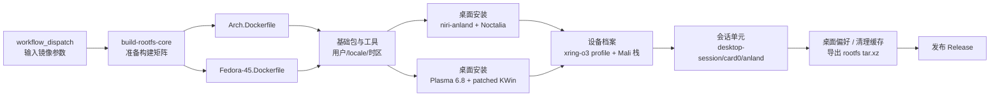

# Droidspaces Arch + niri / Fedora + KDE RootFS 构建（XRING-O3）

为 **小米平板 9 Pro Max（M367FC / XRing O3 / Android 17 / Mali-G2-Ultra-NX）** 构建可直接导入 Droidspaces 的 ARM64 rootfs。当前有两条设备路径：

| 目标 | 桌面 | 状态 |
| --- | --- | --- |
| **Arch Linux** | niri-anland + Noctalia | 长期验证路径 |
| **Fedora 45** | KDE Plasma 6.8（Anland patched KWin） | 新增适配，用于验证 Fedora 新系统与 MaliBridge 零拷贝 |

两条路径共用同一套 MaliBridge GPU 栈（Mesa + `libvulkan_droidbridge` ICD + `libgbm` 垫片）、xring-o3 设备档案和 desktop-session 编排。

> **GPU / 零拷贝基线（必读）**：niri/KWin 合成器走 zink→MaliBridge；Chrome、Electron、WebKit/Tauri、Zen、Qt/GTK4 的 dmabuf 零拷贝与通用启用方式见 [`docs/gpu-zero-copy.md`](docs/gpu-zero-copy.md)。修改会话环境、`zc-run`、应用 wrapper、Mali 栈或 systemd 会话单元前，先读该文档并复跑验收命令；第 7 节“已知边界”中的旧结论以第 8 节为准。

本仓库 fork 自 [Goldzxcbug/Droidspaces-rootfs-Desktop-builder](https://github.com/Goldzxcbug/Droidspaces-rootfs-Desktop-builder)，默认分支 **`xring-o3-mali`**，在保留通用多发行版构建的同时增加 `xring-o3` 设备档案。宿主脚本、KSU 模块、Mali 栈 bundle 与补丁在配套仓库 [collegeming/xring-o3-droidspaces-package](https://github.com/collegeming/xring-o3-droidspaces-package)。

## 1. 目标与产物

一次构建产出一个 rootfs 归档：

```
Arch-niri-Wayland-Droidspaces-rootfs-aarch64-<build_id>.tar.xz
Fedora-kde-Wayland-Droidspaces-rootfs-aarch64-<build_id>.tar.xz
```

归档内包含：

| 层 | Arch + niri | Fedora 45 + KDE |
| --- | --- | --- |
| 基础系统 | Arch Linux ARM64，用户 `colle`（uid 1000），中文 locale + 上海时区 | Fedora 45 ARM64，同一用户/locale/时区 |
| 桌面 | niri-anland（Touch seat / Smithay AFBC 补丁）、Noctalia、desktop-session | Plasma 6.8.1（`startplasma-wayland`）、Anland patched KWin 6.8.1、desktop-session |
| GPU | Mali 栈 bundle：kopper/dt-retire Mesa、format/hook2 ICD、wl-gone shim、`libgbm` 垫片、`libdrmfake`、zc-run、mbctl | 同一 bundle；KDE 使用发行版 Mesa（zink）+ format ICD + `libgbm` 垫片 |
| 输入法 | fcitx5 + Rime（rime-ice），`Shift_L` 切中英文 | fcitx5 + 中文输入（`fcitx5-chinese-addons`） |
| 应用与工具 | kitty、nemo、neovim、fish、mark-shot-arch-bin、Chrome | Konsole、Dolphin、Kate、Spectacle 等 Plasma 应用 |
| 运行时配置 | niri 输出块与 F1/F3 绑定、Noctalia 包装、WebKit/Gecko 沙箱开关、pacman 钩子 | KWin 合成配置、`KWIN_RENDER_NODES`、KDE 会话 GPU 环境、dnf 的 kwin 版本排除 |

目标：

1. 设备档案只接受 `Arch+niri` 与 `Fedora-45+kde` 两种组合，其他组合在构建入口直接失败。
2. GPU 栈版本通过 URL + sha256 固定，缺失时构建直接失败，不产出无 GPU 的镜像。
3. 应用安装后不需要手工补环境：Arch 上桌面条目由 pacman 钩子包装、Chromium 的 sandbox helper 由钩子修正；Fedora 上 KWin 会话由 `kde-session-env.sh` 注入 GPU 环境。
4. 镜像内的偏好与设备验收口径一致：Arch 保留 niri/Noctalia/Rime；Fedora 保留 Plasma 默认外观和 fcitx5。

## 2. 构建流水线



入口 workflow 是 `build-rootfs-releases.yml`，它调用可复用的 `build-rootfs-core.yml`。`setup` 生成构建矩阵与 `build_id`，`build` 按发行版/桌面组合构建，`release` 在 `publish_release=true` 时创建 release 并上传 `.tar.xz`。

### 2.1 设备档案参数

| 输入 | Arch 路径 | Fedora 路径 | 说明 |
| --- | --- | --- | --- |
| `build_target` | `Arch` | `Fedora-45` | 只接受这两个值 |
| `desktop` | `Niri` | `KDE` | 与目标绑定 |
| `display_backend` | `anland-wayland` | `anland-wayland` | 固定 |
| `custom_username` | `colle` | `colle` | uid 必须为 1000 |
| `device_profile` | `xring-o3` | `xring-o3` | 安装设备档案与 Mali 栈；缺少 bundle 参数时硬失败 |
| `apply_preferences` | `true` | 无效果 | Fedora 镜像跳过 Arch 专属偏好脚本 |
| `wayland_package_repository` | `collegeming/xring-o3-droidspaces-package` | 同左 | niri/niri-anland 包来源 |
| `output_scale` / `output_mode` | `2` / `native` | 无效果 | 只对 niri 的 `anland-0` 输出块生效 |
| `mali_stack_bundle_url` | xring Releases 的 bundle URL | 同左 | 与 sha256 必须成对提供 |
| `mali_stack_bundle_sha256` | 对应 sha256 | 同左 | 固定 GPU 栈内容 |
| `mali_stack_version` | 版本标识 | 同左 | 安装目录名 |

### 2.2 构建阶段的固定点

- 基础镜像：Arch 用 `ogarcia/archlinux`，Fedora 用 `fedora:45`；多阶段 Dockerfile 的 `customizer` 阶段完成安装，`export` 阶段只导出 rootfs。
- xring kit：`Arch.Dockerfile` / `Fedora-45.Dockerfile` 的 `XRING_O3_KIT_REF` 固定 xring 仓库 commit，构建时浅克隆并安装 `rootfs/device/xring-o3`。
- Mali 栈：`MALI_STACK_BUNDLE_URL`、`MALI_STACK_BUNDLE_SHA256`、`MALI_STACK_VERSION` 作为 build args 传入；安装器校验布局、ELF 架构与 SHA256SUMS。
- niri/niri-anland：通过 `wayland_package_repository` 指向 xring 的 `anland-niri-packages` release，避免在镜像里本地编译。
- Fedora KWin：`build-anland-kde-packages.yml` 在 `fedora:45` 容器里从 Fedora KWin SRPM 构建 Anland patched KWin，发布到本仓库 `anland-kde-packages` Release；`Fedora-45.Dockerfile` 通过 `install-anland-kde.sh` 安装，运行期由 dnf `excludepkgs=kwin*` 锁定，避免升级覆盖 Anland backend。

## 3. 镜像内改造

### 3.1 桌面与显示

**问题**：niri 需要固定的输出块和会话环境；Anland 需要每个容器独立的 socket 与显示切换；容器启动顺序可能与 bridge 错位。

**改造**：

- `configure-desktop.sh`：安装 niri 桌面与依赖，铺设默认 niri 配置，写入 `anland-0` 的输出块（`scale 2`、`mode native`）。
- `niri-default-config.kdl`：默认配置包含输出、截图路径、`Print`/`Ctrl+Print`/`Alt+Print` 截图绑定，以及 `F1`/`F3` 的 mark-shot 绑定。
- `start-desktop-session.sh`：进入 niri 前清理遗留 Xwayland、fcitx5、`wl-copy`，加载 `session-gpu-env.sh`，避免旧进程占用 socket 或显示号。
- `xwayland-satellite-soft.sh`：容器没有 GPU 节点时提供软件 Xwayland 兜底。
- `desktop-session.service` 的 `ExecStartPre` 调用 `wait-for-bridge.sh`，等待 `mali.sock` 与 `control.sock`；超时后由宿主 reconciler 在 bridge 就绪时重启会话。

**适用场景**：首次启动；bridge 晚到；容器重建；切换上屏容器。

### 3.2 GPU 栈与零拷贝启动器

**问题**：不同应用需要不同的 Mesa/ICD/沙箱环境；同一套环境不能同时满足 Chromium、WebKit、Gecko、Qt、GTK4 和终端。

**改造**：

- 安装 Mali 栈 bundle 到 `/opt/mali-stack/<version>`，建立 `current` 链接；写入系统 Vulkan ICD 与默认 bridge socket。
- `/usr/local/bin/zc-run` 是镜像级包装器：先按桌面条目/命令行分类，再调用 bundle 内的实现。Chromium 类固定系统 Mesa 与 format ICD，WebKit 类加载 `libdrmfake` 并关闭沙箱，Gecko 走 Wayland/WebRender，Qt/GTK4/Flutter 设置各自的 Wayland 后端。
- pacman 钩子调用 `xring-wrap-desktop`，只包装 chromium/webkit/gecko/flutter 四类桌面条目；跟随 `#!` 脚本的 `cd`/`exec` 找真实二进制；幂等。
- `mark-shot-arch-bin` 作为截图工具，包含 layer-shell 插件，覆盖层与贴图窗口使用 layer-shell，不会被 tiling 合成器重排。

**适用场景**：Chrome/Electron；WebKitGTK/Tauri；Firefox/Zen；Qt/GTK4；终端；从启动器打开新安装的应用。

### 3.3 零拷贝基线

窗口缓冲零拷贝的判据是 `WAYLAND_DEBUG=1` 下出现 `zwp_linux_dmabuf_v1.create_immed`，且窗口没有 `wl_shm.create_buffer`。完整矩阵、协议版本和证据等级见 xring README 的「零拷贝矩阵与协议版本」。

| 应用 | create_immed | 窗口 `wl_shm` |
| --- | ---: | --- |
| Chrome（单窗口） | 3 | 无 |
| Chrome（3 个 WebGL2 页面） | 9 | 无 |
| kitty | 3 | 无 |
| GTK4 demo | 4 | 无 |
| WebKitGTK MiniBrowser | 8 | 无 |
| IntelliJ IDEA（JBR Java2D Vulkan） | 9 | 无 |

`zwp_linux_dmabuf_v1` 在 niri-anland 上是 version 3：支持 `create_immed` 与 modifier，不提供 v4 feedback/v5 严格校验。零拷贝成立；v4 影响的是每 surface/设备偏好与布局优化。

### 3.4 沙箱与进程环境

**问题**：容器禁止非特权 user namespace；Electron/Chromium 的 namespace sandbox 不可用；WebKitGTK/Tauri 的 bwrap 也会失败；wl-gone shim 通过 `LD_PRELOAD` 注入，泄漏给 JBR 会导致崩溃。

**改造**：

- WebKit/Gecko：xring 设备档案的 `profile.sh` 写入 `WEBKIT_DISABLE_SANDBOX_THIS_IS_DANGEROUS=1`、`QTWEBENGINE_DISABLE_SANDBOX=1`、`MOZ_DISABLE_*_SANDBOX=1`；镜像构建时安装该档案。
- Electron/Chromium：镜像安装 `fix-chrome-sandbox.sh` 与 `/etc/pacman.d/hooks/90-chrome-sandbox.hook`，任何包安装/升级 `chrome-sandbox` 后自动设为 `root:root 4755`；构建末尾再执行一次，覆盖构建阶段安装的应用。
- btop：Arch 包带 `cap_dac_read_search,cap_perfmon` 文件能力；容器 capability bounding set 不含 `cap_dac_read_search`，execve 返回 EPERM（root 也一样）。这是通用问题，不止 btop：任何包的文件能力只要超出 bounding set 都会这样失败。`98-unsupported-filecaps.hook` 在每次 pacman 事务后扫描 `/usr/bin`、`/usr/sbin`、`/usr/lib`、`/usr/lib64`、`/opt`，剥离 bounding set 之外的文件能力并保留受支持的；`99-btop-filecaps.hook` 是 btop 的定点兜底。
- 会话工作目录：`desktop-session.service` 设置 `WorkingDirectory=~`。systemd 默认以 `/` 启动服务，niri 及其派生的 kitty 等应用会继承 `/`；加上后新开终端直接落在 `/home/<user>`。
- wl-gone shim：由 `noctalia-dt` 注入，shim 在构造时把自身从 `LD_PRELOAD` 移除，Noctalia 的子孙进程拿到干净环境；JBR 在 `WLToolkit.initIDs` 中不会因 shim 崩溃。

**适用场景**：VSCode/Discord 等 Electron；Tauri/WebKitGTK；IntelliJ/PyCharm 等 JBR；所有没有 userns 的容器。

### 3.5 输入法、外观与镜像源

**问题**：中文输入需要 fcitx5/Rime 的会话环境与部署产物；ALARM 镜像同步滞后会把“本地包比仓库新”变成安装时的降级冲突。

**改造**：

- `apply-preferences.sh` 写入 IM 环境、配置 fcitx5 profile 只保留 Rime、设置 `Shift_L`/`Shift_R` 行为，生成 Rime `build/default.yaml`，避免 Rime 静默不加载。
- 桌面外观：GTK 暗色、tide Rainbow。
- 镜像源：ALARM 的 mirrorlist 改为阿里云优先、官方兜底，TUNA 注释；避免 stale DB 让 `pacman -S` 把已安装的新版本降级。
- archlinuxcn：用于 paru、rime-ice-git 等 ALARM 官方源没有的包；首次引导 keyring 后恢复签名校验。

**适用场景**：中文输入；首次启动；安装 AUR 应用；镜像源同步滞后时的依赖解析。

### 3.6 应用与工具

| 脚本/配置 | 作用 | 适用场景 |
| --- | --- | --- |
| `configure-chrome.sh` | 安装原生 ARM64 Google Chrome，生成启动包装 | Chrome |
| `configure-mark-shot.sh` | 安装 AUR `mark-shot-arch-bin`，校验 aarch64 产物、依赖与 layer-shell 插件 | 截图/贴图 |
| `fix-chrome-sandbox.sh` + `90-chrome-sandbox.hook` | 安装/升级后把 `chrome-sandbox` 修正为 4755 | Electron/Chromium |
| `xring-wrap-desktop`（来自 xring kit） | 包装 Web 引擎桌面条目 | 启动器 |
| `niri-default-config.kdl` | 输出、截图路径、Print 与 F1/F3 绑定 | niri 会话 |
| `bashrc.sh` | shell 别名与环境 | 终端 |

### 3.7 Fedora 45 + KDE 适配

**问题**：Fedora 45 的 Plasma 是 6.8.1，KWin 只有 DRM/virtual 后端，不能直接连 Anland；KWin 6.8 需要 `RenderDevice`，而容器只有 `/dev/dri/card0`、没有 `renderD`；把 niri 用的 kopper Mesa 直接给 KWin 会在 `eglInitialize` 段错误（kopper 26.3 与发行版 `libgbm` 的 `gbm_device` ABI 不一致）。

**改造**：

- **patched KWin**：`build-anland-kde-packages.yml` 在 `fedora:45` 容器里用 Anland 的 `producers/kde/Fedora43_v5/build.sh` 从 Fedora KWin SRPM 构建，后端按 `ANLAND_KWIN_68` 编译，发布到本仓库 `anland-kde-packages` Release；`install-anland-kde.sh` 增加 `fedora:45` → `fedora45` 资产映射，安装后把 `kwin*` 写入 dnf 排除，防止升级覆盖。
- **KWin 渲染设备**：`kde-session-env.sh` 设置 `KWIN_RENDER_NODES=/dev/dri/card0` 与 `ANLAND_DRM_DEVICE=/dev/dri/card0`。KWin 6.8 的 `GpuManager` 支持显式 `KWIN_RENDER_NODES`，绕过“只枚举 render node”的限制。
- **GPU 栈选择**：KDE 使用 Fedora 的 Mesa 26.2（zink）+ MaliBridge `droidbridge-format.json` + bundle 的 `libgbm` 垫片（强制 LINEAR）。`kde-session-env.sh` 只把 `current/lib` 放进 `LD_LIBRARY_PATH`，不引入 kopper，保证 `libgbm` 与 `libEGL_mesa` 来自同一份 Mesa。
- **合成配置**：`configure-desktop.sh` 为 KDE 写 `kwinrc`：`Enabled=true`、`Backend=OpenGL`；旧的 `Enabled=false` 只适用于无 GPU 的 X11 容器。
- **音频**：Anland 音频保持启用（`ANLAND_DISABLE_AUDIO` 已移除）；`anland-speaker`/`anland-microphone` 由 Anland 音频引擎创建。
- **不安装 `kwin-x11`**：Fedora 45 仓库里它是 6.7.5 的社区包，与 6.8 的 Plasma 不同步；KDE 固定 `startplasma-wayland`。

**适用场景**：Fedora 45 + KDE 镜像；KWin 包升级；排查 KDE 黑屏/软件渲染。

### 3.8 Noctalia Mali GPU 插件

**问题**：btop、Mission Center 和 Noctalia 自带的 sysmon 只支持 NVIDIA/AMD/Intel，Mali 没有后端；Mali kbase 也没有可用的 GPU busy 计数（debugfs `dvfs_utilization` 冻结/下溢）。

**改造**：

- 插件源码在 xring 仓库 `src/noctalia-mali-gpu/`（与 `mbctl` 同层），镜像构建时从固定 commit 的 xring kit 复制到 `/usr/local/share/droidspaces/noctalia-plugins/mali-gpu`，再由 `apply-preferences.sh` 安装到 `~/.local/share/noctalia/plugins/mali-gpu`。
- 顶栏显示 `GPU <频率>M <温度>°`；悬浮显示型号、频率区间、温度、MaliBridge 预算/占用、每应用 FPS（`malibridge-report.json` 的 `fps_p50`）。
- 不伪造“GPU 占用率”：数据源没有可信的 busy 计数，只展示频率、温度、显存和 FPS。
- 点击图标打开预算面板，复刻原 mb-tray 的预算预设、立即应用、应用并保存、打开报告/日志；Arch 镜像不再安装/自启动 mb-tray；Fedora KDE 镜像仍保留 mb-tray 作为托盘。

**适用场景**：日常观察 GPU 频率/温度/桥接显存；定位 MaliBridge 内存预算与应用 FPS。

## 4. 仓库结构

| 路径 | 内容 | 对应改造 |
| --- | --- | --- |
| `Arch.Dockerfile` | Arch + niri + xring-o3 设备档案；安装顺序、build args、清理与导出 | 全流程 |
| `Fedora-45.Dockerfile` | Fedora 45 + KDE + xring-o3 设备档案；KWin 包安装、Mali 栈、会话环境 | 3.1、3.7 |
| `Debian-13.Dockerfile`、`Ubuntu-*.Dockerfile`、`Fedora-43/44.Dockerfile` | 上游通用模板（本分支不构建，入口直接失败） | 非本设备 |
| `scripts/configure-desktop.sh` | 桌面安装、niri 配置与输出块、KDE `kwinrc` | 3.1、3.7 |
| `scripts/kde-session-env.sh` | KDE 会话 GPU 环境（system Mesa + shim + `KWIN_RENDER_NODES`） | 3.7 |
| `scripts/desktops/kde.sh` | Fedora 45 Plasma 包安装与 `/etc/environment` 变量 | 3.7 |
| `scripts/tui/install-anland-kde.sh` | 下载/安装 patched KWin；`fedora:45` 资产映射与 dnf 锁定 | 3.7 |
| `scripts/configure-chrome.sh` | Chrome 安装与包装 | 3.6 |
| `scripts/configure-mark-shot.sh` | mark-shot-arch-bin 安装 | 3.6 |
| `scripts/fix-chrome-sandbox.sh` | sandbox helper 权限修正 | 3.4 |
| `scripts/etc/pacman.d/hooks/90-chrome-sandbox.hook` | 安装/升级触发修正 | 3.4 |
| `scripts/etc/niri-default-config.kdl` | niri 默认配置与快捷键 | 3.1、3.6 |
| `scripts/start-desktop-session.sh` | 会话清理与启动（niri / KDE 分支） | 3.1、3.7 |
| `scripts/xwayland-satellite-soft.sh` | 软件 Xwayland 兜底 | 3.1 |
| `scripts/preferences/apply-preferences.sh` | 镜像源、IM、Noctalia、niri extras、archlinuxcn | 3.5 |
| `scripts/desktops/` | 各桌面安装脚本 | 上游通用 |
| `scripts/tui/` | TUI 安装器与 GPU 探测 | 上游通用 |
| `.github/workflows/build-rootfs-releases.yml` | 手动入口与发布 | 全流程 |
| `.github/workflows/build-rootfs-core.yml` | 可复用构建矩阵 | 全流程 |
| `.github/workflows/build-anland-kde-packages.yml` | 在 `fedora:45` 构建 patched KWin 并发布 | 3.7 |
| `docs/build-image-xring-o3.md` | 本设备构建命令行示例 | 全流程 |
| `docs/zh/`、`docs/en/` | 上游通用文档 | 非本设备 |

## 5. 使用场景速查

| 场景 | 步骤 | 注意 |
| --- | --- | --- |
| 构建 Arch 镜像 | Actions → 编译并发布 RootFS → `Arch` + `Niri` | `device_profile=xring-o3` 时必须提供 bundle URL/sha256 |
| 构建 Fedora KDE 镜像 | Actions → 编译并发布 RootFS → `Fedora-45` + `KDE` | 先确认 `anland-kde-packages` Release 里有 `fedora45` 资产 |
| 升级 patched KWin | Actions → 构建 Anland KDE 补丁包（Fedora 45） → 发布 | 同 tag 资产被覆盖；重建镜像才会带上新版本 |
| 升级 Mali 栈 | 在 xring 发布新 bundle → 更新 URL/sha256/version → 重新构建 | 版本目录并存，`current` 原子切换 |
| 新装 Electron 应用（Arch） | `paru -S <pkg>` | pacman 钩子修正 helper；桌面条目由 wrap 钩子包装 |
| 新装 WebKit/Tauri 应用（Arch） | `paru -S <pkg>` | WebKit 沙箱由会话环境关闭；条目包装为 webkit |
| 新装 KDE 应用（Fedora） | `dnf install <pkg>` | 应用直接继承 KWin 会话的 Mesa/ICD；不要升级 `kwin*` |
| 导入设备 | 解压到容器 rootfs，创建容器配置，`droidspaces start` | 需要 `enable_anland=1`、`enable_gpu_mode=1`、绑定 `/dev/dma_heap` |
| 切换上屏容器 | xring 的 `anland-link.sh` + Anland consumer intent | 同一时间只有一个容器上屏 |
| 离线复现 | 预先下载 Mali 栈 bundle 与 niri 包 | 构建仍需网络安装 Arch 包 |

## 6. 验证基线

基线：2026-11-13，builder 当前分支构建的 Arch 镜像（Mali 栈 2026.11.12-v1）；零拷贝计数来自 archniri21 同栈基线，IDEA 计数来自 archniri23。Fedora 45 + KDE 的 GPU/零拷贝基线在首个 Fedora 镜像建成后补充。

```sh
# Arch
xz -t Arch-niri-Wayland-Droidspaces-rootfs-aarch64-*.tar.xz
tar -tf ... | grep -E 'niri-default-config.kdl|90-chrome-sandbox.hook'
systemctl status desktop-session
wayland-info | grep -A2 zwp_linux_dmabuf_v1
pacman -Q mark-shot-arch-bin
ls -l /usr/lib/mark-shot/libmark-shot-layer-shell.so
niri validate -c /home/colle/.config/niri/config.kdl
ls -l /usr/share/code/chrome-sandbox   # 安装 Electron 应用后应为 4755

# Fedora 45 + KDE
xz -t Fedora-kde-Wayland-Droidspaces-rootfs-aarch64-*.tar.xz
tar -tf ... | grep -E 'kde-session-env.sh|kwinrc'
systemctl status desktop-session
rpm -q kwin                            # 应带 .anland 发行号
grep -E '^excludepkgs=.*kwin' /etc/dnf/dnf.conf
journalctl -b -u desktop-session | grep -i 'anland\|egl\|gl'
```

| 检查 | 结果 |
| --- | --- |
| rootfs 归档 | `xz -t` 通过；Arch 含 niri 配置/Mali 栈/pacman 钩子，Fedora 含 KWin 包/会话环境/`kwinrc` |
| 桌面会话（Arch） | niri-anland + Noctalia + fcitx5 正常 |
| 桌面会话（Fedora） | `startplasma-wayland` + patched KWin 起来，输出层连上 Anland daemon |
| GPU（Fedora） | KWin 日志/`glxinfo -B` 显示 `zink Vulkan ... Mali-G2-Ultra-NX`；`KWIN_RENDER_NODES=/dev/dri/card0` 生效 |
| dmabuf | `zwp_linux_dmabuf_v1` version 3；`create_immed` 正常 |
| 零拷贝（Arch） | 窗口缓冲为 DMA-BUF；计数见 3.3 |
| mark-shot | F1 覆盖层、F3 贴图均使用 layer-shell（Arch） |
| Electron sandbox | 安装/升级后 pacman 钩子触发，`chrome-sandbox` 为 4755；应用以桌面用户运行（镜像 23 上验证钩子） |
| 镜像源 | Arch：`pacman -Si gstreamer` 与本地版本一致；Fedora：dnf 不升级 `kwin*` |

## 7. 已知边界

1. **L-C scanout 未取证**：L-A/L-B 已实测（create_immed + dma-buf image）；合成器导入到 Android 的 fence/scanout trace 尚未做，不能把 L-B 说成全链路零拷贝。
2. **dmabuf v3 是当前预期值**：容器无 EGL render node，niri 只能发 v3；v3 仍支持 `create_immed`，不阻断零拷贝。不要创建 `renderD128`（会导致 niri 重启循环）。
3. **Xwayland 默认 GPU、可回退软件**：`xwayland-satellite-soft` 用 card0 + 发行版 Mesa + zink + format ICD 探测成功后走 GPU，失败才回退 llvmpipe；不要再无条件强制 llvmpipe。
4. **容器无 userns**：Electron/Chromium 依赖 SUID helper；非 pacman 安装的应用可能需要手动修正 helper 或 `--no-sandbox`。
5. **镜像源滞后**：Arch 的阿里云/官方优先仍可能出现“本地包比仓库新”的警告；安装依赖时确认不会触发降级。
6. **Chrome WebGL 闪烁未定位**：已排除 ANGLE、syncobj、软件合成与 Chrome 版本差异；问题仍在跟踪。
7. **120Hz 未达**：Chrome WebGL 约 60 FPS。
8. **Java2D Vulkan 回退**：宿主可用内存接近预算下限时，`vkCreateDevice` 可能返回 `VK_ERROR_OUT_OF_DEVICE_MEMORY`，JBR 回退路径存在低频崩溃风险。
9. **临时 root**：设备重启后需重新 root、加载 LKM、启动容器与 bridge。
10. **功耗不可排名**：设备充电时传感器数据不能用于整机功耗排名。
11. **Fedora KDE 是新增路径**：patched KWin 来自本仓库 `anland-kde-packages` 固定滚动 Release，升级 KWin 必须重建镜像；音频已启用并验证；`mark-shot`/Rime 等 Arch 专属偏好不随 Fedora 镜像提供；WebKit 目前仍被 `WEBKIT_DISABLE_DMABUF_RENDERER=1` 强制 SHM，需按 GPU 文档改为 0。
12. **KWin 6.9 未适配**：Anland 后端目前只覆盖到 `ANLAND_KWIN_68`；Fedora 升级到 KWin 6.9 前要先更新 Anland producer。
13. **Mission Center 信息不完整**：GPU 页只支持 Intel/AMD/NVIDIA（通过 nvtop），Mali 没有对应后端，所以看不到 GPU；网络页依赖 NetworkManager 的 D-Bus 对象，镜像没有安装 NM，因此没有网络项；容器内没有 `hwmon`，风扇/温度页也不出现。CPU、内存、磁盘、进程、服务页正常；驱动器列表来自宿主共享的 sysfs（sda–sdd），不代表容器自己的磁盘。

## 8. GPU / 零拷贝实现基线（必读，2026-11-15）

完整方案、文件路径、历史根因与验收命令见 [`docs/gpu-zero-copy.md`](docs/gpu-zero-copy.md)。这里只列不得丢失的结论：

- **通用启用**：Arch niri 会话由 `session-gpu-env.sh` 注入 kopper Mesa + zink + `droidbridge-format.json` + `VKBRIDGE_SOCKET`，niri spawn 的 Qt/GTK4/kitty/Noctalia 默认继承；Chrome/Electron/WebKit/Xwayland 由 `zc-run` 或专用 wrapper 切换到发行版 Mesa/垫片。
- **应用矩阵**：Qt6/Qt5、GTK4、kitty `create_immed>0`/`pool=0`；Chromium `gpu_compositing=enabled` + 窗口 dmabuf；Electron 42 窗口尺寸 `create_immed`；WebKitGTK/Tauri 需 `libdrmfake` + `WEBKIT_WEB_RENDER_DEVICE_FILE=/dev/dri/card0` + `DISABLE_GBM=1`；Zen 需 `zc-run --class gecko` + user.js；Xwayland 用 GPU 优先 wrapper。
- **2026-11-15 复测**：Qt6/kitty `immed=3/pool=0`；Electron 42 `immed=5/pool=2`（仅光标池）；WebKitGTK 静态页 `immed=8/pool=0`；Chrome `gpu_compositing=enabled`；Xwayland `glxinfo` zink Mali/Accelerated yes。裸 shell 启动 Qt/kitty 需显式导出会话 GPU env，niri spawn 的应用自动继承。
- **硬规则**：不建 `renderD128`；`/etc/environment` 不写 `WAYLAND_DISPLAY`；Chromium/Electron/Xwayland 不用 kopper Mesa；不覆盖 `zc-run` 符号链接；不在 live 会话跑 WebKit 整屏动画（bridge per-client 2GB 预算会崩）。
- **Xwayland 启动探测**：`xwayland-satellite-soft` 对 `--test-listenfd-support` 必须直接透传，不得在该路径连接 Wayland（`wayland-info`）做探测；niri 启动早期会同步 `wait4` 等它退出，任何 Wayland 探测都会互锁，表现为黑屏、Noctalia 不启动。
- **事故背景**：23:50 WebKit 动画测试打满 2GB 预算，`vkbridge-server` 在 `vkBindBufferMemory` 空指针 SIGSEGV，niri DEVICE_LOST 崩溃；bridge 未恢复时不要重启 desktop-session。null-guard 候选已隔离验证通过（4 条 bind 路径返回 `VK_ERROR_OUT_OF_DEVICE_MEMORY`，旧版同场景 SIGSEGV；live 已部署 `16c464ef…`）。

## 9. 关联项目

| 项目 | 关系 |
| --- | --- |
| [collegeming/xring-o3-droidspaces-package](https://github.com/collegeming/xring-o3-droidspaces-package) | 宿主脚本、KSU 模块、Mali 栈 bundle、niri 包、补丁 |
| [Goldzxcbug/Droidspaces-rootfs-Desktop-builder](https://github.com/Goldzxcbug/Droidspaces-rootfs-Desktop-builder) | 本仓库上游模板 |
| [ravindu644/Droidspaces-OSS](https://github.com/ravindu644/Droidspaces-OSS) | Droidspaces 运行时 |
| [ASEbrahim/MaliBridge](https://github.com/ASEbrahim/MaliBridge) | MaliBridge 上游 |
| [collegeming/anland-mali](https://github.com/collegeming/anland-mali) | 本设备 Anland fork |
| [YaLTeR/niri](https://github.com/YaLTeR/niri) / [Noctalia](https://github.com/noctalia-dev/noctalia) | 合成器与桌面 shell |
| [iDvel/rime-ice](https://github.com/iDvel/rime-ice) | Rime 雾凇拼音 |

本仓库只保存镜像构建脚本、桌面偏好与设备档案；上游源码、宿主脚本、MaliBridge/Anland 补丁分别在对应仓库与 xring 仓库维护。设备运行日志与完整验证记录不在本仓库。
